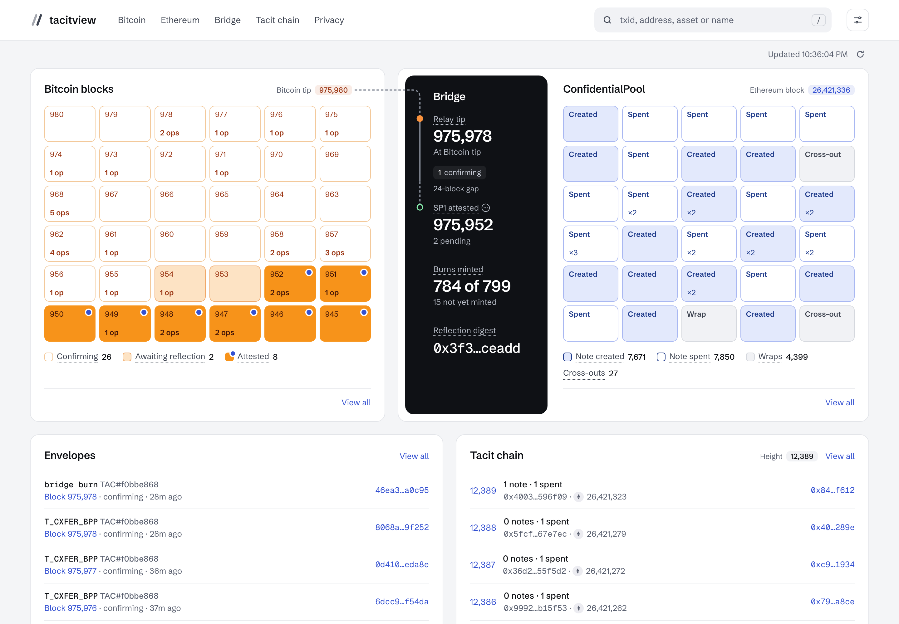
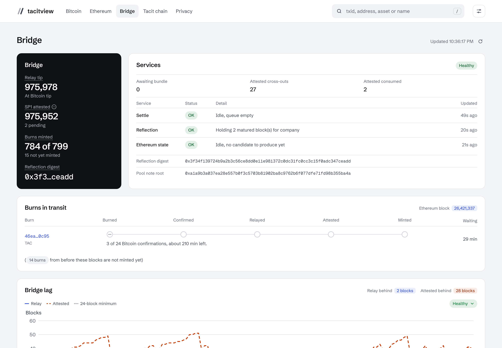
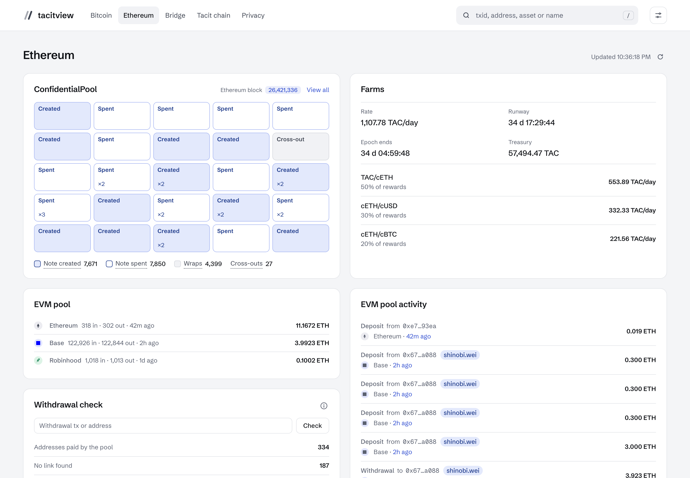
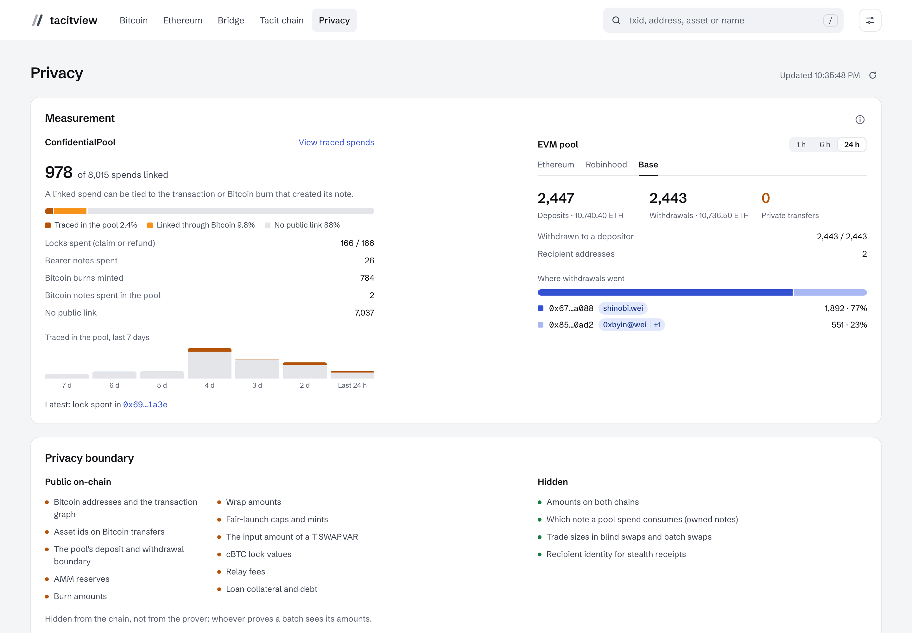

# tacitview

A live, read-only explorer for Tacit across Bitcoin, the bridge and Ethereum.

**Live:** https://tacitview.vercel.app



Tacit issues confidential assets on Bitcoin and moves them to Ethereum through a bridge proven with SP1 (a zero-knowledge prover). tacitview shows both chains and the bridge between them on one site. Chain data is read from the chains themselves, so those numbers can be checked instead of trusted. Built for the poidh bounty ["Vibecode a Tacit Explorer"](https://poidh.xyz/base/bounty/1519).

## Features

- **Bitcoin:** blocks with their Tacit envelopes, every operation decoded from the raw transaction, assets and AMM pools.
- **Bridge:** the newest Bitcoin block known on Ethereum (relay tip) and the newest one proven (SP1 attested), each burn followed until it is minted on Ethereum, and a 24 hours lag chart with a health status. On the home page a line runs from the Bitcoin tip through the relay and the proof into the ConfidentialPool, the same path a burn takes.
- **Ethereum:** ConfidentialPool notes, the EVM pool on Ethereum, Base and Robinhood, cBTC backing, cUSD and farms.
- **Tacit chain:** Tacit's chain of settled batches, rebuilt here from Ethereum with Tacit's own numbering rule. Each block shows whether its hash matches the one Tacit publishes, and your browser can redo the hash itself.
- **Verifier:** Tacit's API figures (attested height, pool spends, the newest Tacit chain block, bridge mints) next to the same figures read on-chain, with the `cast` and `curl` commands to check both.
- **Transactions:** settle calls are decoded into notes spent and created, deposits, withdrawals, fees, swaps and bridge mints.
- **Search:** Bitcoin txid, asset id, Bitcoin or EVM address, Ethereum tx hash, `tacit1` ID, or a name (XNS, ENS, .wei, .gwei, Basenames).

| Bridge | Ethereum |
| --- | --- |
|  |  |

## Privacy

Some things in Tacit stay hidden and some are public. The Privacy page shows both, with numbers measured since each pool was deployed.

- **Hidden:** note amounts (Pedersen commitments), which note an owned-note spend used, and the link between a stealth receipt and its receiver.
- **Public:** timing, counts and fees, Bitcoin addresses, and any amount that crosses the boundary (wraps, deposits, burns).

On top of that, the site measures 2 kinds of links that anyone can make from public data. Figures are from 15 Nov 2026.

- **Traced spends:** 192 of 8,015 ConfidentialPool spends can be traced to the note they spent. These are bearer notes (spendable by whoever holds them) and locks, whose spend tag is `keccak(leaf ‖ "spent")` of a public leaf, so anyone can match the two.
- **Withdrawal check:** 147 of the 334 addresses paid by the EVM pool can be tied to a deposit, by the address paid or by the wallet that sent the withdrawal. However, 6 addresses that deposit and withdraw again and again make up 96% of these linked withdrawals.



## Data sources

- **Bitcoin:** four Esplora servers (mempool.space, blockstream.info, emzy, bitaroo), with fallback between them.
- **Ethereum, Base and Robinhood:** public RPC nodes, with an archive node for older logs.
- **Tacit API:** only for data with no on-chain copy, such as prover health, the relay queue, points, the asset list, AMM reserves and farm figures.

The ConfidentialPool and EVM pool histories, the Tacit chain and every bridge burn and mint are rebuilt from the chains, not from Tacit's API. They ship as snapshots in `server/data/`, and the server reads every newer block by itself. As a check, the Verifier compares the pool's spend count, the newest Tacit chain block and the bridge mints with Tacit's own numbers. A burn counts when it names this pool in its envelope, so a few early burns made for an older deployment are left out.

## Visitor privacy

- The page only talks to its own origin. There are no analytics, cookies or third-party scripts, and the content security policy blocks every other address (`default-src 'self'`).
- Nothing is looked up until you ask for it. Hovering a link sends no request, and recent searches are forgotten when the tab closes.
- The server keeps no logs of its own, forwards nothing about you upstream, and rate-limits by a salted hash of your IP that is gone after a minute.
- Searches still pass through the server, so the server and the upstream sources can see what is looked up. Settings has a button to clear everything the site stored on your device.

### Use your own node

The block check on Tacit chain pages can read Ethereum from your own node instead of this site. Set its address in Settings (only `localhost` or `127.0.0.1` is allowed), and start the node with this site allowed, for example `geth --http --http.corsdomain https://tacitview.vercel.app`. The site then only supplies the block's hash, and your browser checks it against data from your own node.

When you run tacitview yourself, these variables replace the public endpoints, so no third-party node sees your lookups:

```sh
TACITVIEW_ETH_RPC=http://127.0.0.1:8545 TACITVIEW_ESPLORA=http://127.0.0.1:3002/api npm run dev
```

`TACITVIEW_BASE_RPC` and `TACITVIEW_ROBINHOOD_RPC` work the same way for Base and Robinhood.

## Run locally

Node.js 20 or newer, no dependencies to install.

```sh
npm run dev            # http://localhost:4173
npm run test:offline   # offline tests
npm test               # offline tests plus live checks against mainnet
npm run test:mutants   # plants bugs one at a time and checks the tests catch each
```

Refresh the snapshots before a deploy (each one reads only the blocks since its last build):

```sh
node scripts/privacy-snapshot.mjs
node scripts/evm-snapshot.mjs --update
node scripts/burn-snapshot.mjs
```

## How it is built

Plain HTML, CSS and ES modules, with no framework and no build step. A small Node server answers `/api` with GET only, and on Vercel the same code runs as one function (`api/proxy.js`). Each route has its own cache time, so the CDN answers repeat visits and the upstream sources see about one request per route per cache time.

## License

MIT, see [LICENSE](LICENSE).
